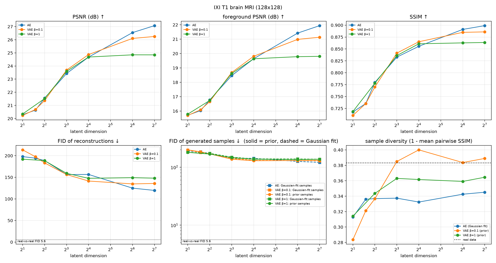
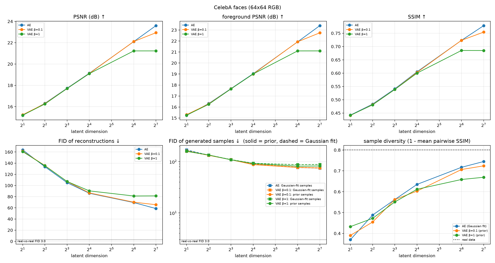
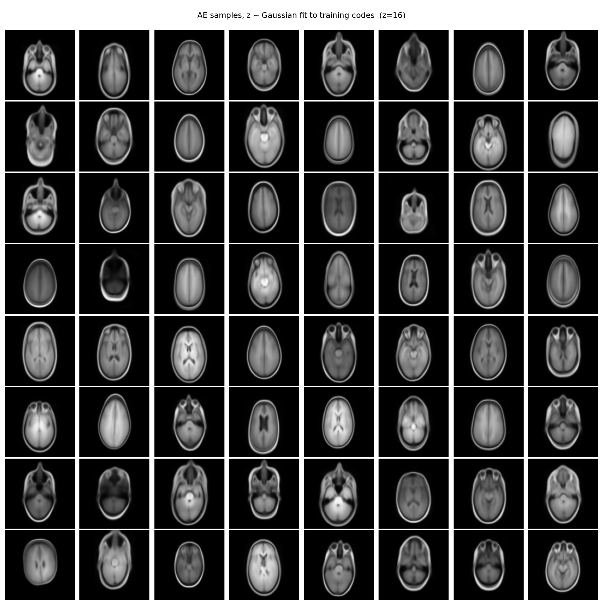

# MedLatent — Autoencoders on brain MRI and faces (latent size 2 → 128)

Convolutional **autoencoders** trained with latent dimensions **2 to 128** on two very different datasets:
**IXI brain MRI** (healthy adults, T1 axial slices) and **CelebA** faces. They are part of a controlled AE-vs-VAE study:
same architecture, data, optimiser and schedule. The only differences are the latent layer.

* Companion repo: **[Variational-AutoEncoders](https://github.com/ChandraPrakash-Bathula/Variational-AutoEncoders)** (weights: [medlatent-autoencoder](https://huggingface.co/ChandraPrakashBathula/medlatent-autoencoder))
* Interactive demo — latent clusters (PCA / t-SNE / UMAP, 2-D / 3-D), real vs generated images, latent walks, dataset comparison:
  **[MedLatent Studio](https://huggingface.co/spaces/ChandraPrakashBathula/medlatent-studio)**

> ⚠️ **Research models, not medical devices.** Reconstructions and generated brain images are not diagnostic images.

## Results (held-out test set)

### IXI brain MRI — 128×128 grayscale T1 slices
| run | z | PSNR (dB) | fg PSNR | SSIM | FID recon ↓ | FID Gaussian-fit samples ↓ | best epoch |
|---|---|---|---|---|---|---|---|
| [`ixi/z2`](https://huggingface.co/ChandraPrakashBathula/medlatent-autoencoder/tree/main/ixi/z2) | 2 | 20.29 | 15.71 | 0.718 | 197.9 | 189.9 | 95 |
| [`ixi/z3`](https://huggingface.co/ChandraPrakashBathula/medlatent-autoencoder/tree/main/ixi/z3) | 3 | 20.64 | 16.03 | 0.735 | 194.3 | 184.0 | 74 |
| [`ixi/z4`](https://huggingface.co/ChandraPrakashBathula/medlatent-autoencoder/tree/main/ixi/z4) | 4 | 21.56 | 16.77 | 0.780 | 188.7 | 172.3 | 80 |
| [`ixi/z8`](https://huggingface.co/ChandraPrakashBathula/medlatent-autoencoder/tree/main/ixi/z8) | 8 | 23.43 | 18.46 | 0.833 | 156.4 | 142.8 | 51 |
| [`ixi/z16`](https://huggingface.co/ChandraPrakashBathula/medlatent-autoencoder/tree/main/ixi/z16) | 16 | 24.68 | 19.64 | 0.856 | 156.6 | 142.2 | 21 |
| [`ixi/z64`](https://huggingface.co/ChandraPrakashBathula/medlatent-autoencoder/tree/main/ixi/z64) | 64 | 26.54 | 21.42 | 0.891 | 124.9 | 125.7 | 67 |
| [`ixi/z128`](https://huggingface.co/ChandraPrakashBathula/medlatent-autoencoder/tree/main/ixi/z128) | 128 | 27.07 | 21.94 | 0.899 | 119.6 | 121.0 | 84 |

*Real-vs-real FID on this dataset: 5.6 (the best achievable reference).*



### CelebA faces — 64×64 RGB
| run | z | PSNR (dB) | fg PSNR | SSIM | FID recon ↓ | FID Gaussian-fit samples ↓ | best epoch |
|---|---|---|---|---|---|---|---|
| [`celeba/z2`](https://huggingface.co/ChandraPrakashBathula/medlatent-autoencoder/tree/main/celeba/z2) | 2 | 15.17 | 15.24 | 0.442 | 163.8 | 170.0 | 50 |
| [`celeba/z4`](https://huggingface.co/ChandraPrakashBathula/medlatent-autoencoder/tree/main/celeba/z4) | 4 | 16.31 | 16.32 | 0.484 | 133.6 | 133.4 | 48 |
| [`celeba/z8`](https://huggingface.co/ChandraPrakashBathula/medlatent-autoencoder/tree/main/celeba/z8) | 8 | 17.73 | 17.67 | 0.541 | 105.0 | 109.5 | 50 |
| [`celeba/z16`](https://huggingface.co/ChandraPrakashBathula/medlatent-autoencoder/tree/main/celeba/z16) | 16 | 19.14 | 19.03 | 0.605 | 86.1 | 89.2 | 39 |
| [`celeba/z64`](https://huggingface.co/ChandraPrakashBathula/medlatent-autoencoder/tree/main/celeba/z64) | 64 | 22.10 | 21.92 | 0.723 | 69.4 | 76.8 | 45 |
| [`celeba/z128`](https://huggingface.co/ChandraPrakashBathula/medlatent-autoencoder/tree/main/celeba/z128) | 128 | 23.60 | 23.40 | 0.778 | 58.7 | 74.8 | 48 |

*Real-vs-real FID on this dataset: 3.0 (the best achievable reference).*



Samples from a z = 16 model (IXI):



**Metrics.** PSNR/SSIM on the full image; *fg PSNR* only on foreground pixels (the black background inflates PSNR).
FID with the standard InceptionV3 features (grayscale repeated to RGB, up to 10,000 test images). FID is only comparable
within a dataset. Generation for the AE: decode codes drawn from a full-covariance Gaussian fitted to the training codes (`latent_gaussian.npz`).
Single seed per configuration; treat differences below ~0.2 dB / a few FID points as noise.

## Run it yourself

```bash
pip install -r requirements.txt          # install the PyTorch build for your CUDA first

# data
python data/preprocess_ixi.py --raw-dir data/raw/IXI-T1 --download     # IXI T1 -> 128x128 slices, split by subject
python data/preprocess_celeba.py                                         # CelebA -> 64x64 RGB (HF mirror, official split)

# train + evaluate (IXI)
python -m autoencoder.train --latent-dim 16
python -m autoencoder.evaluate --run-dir outputs/ae/z16

# CelebA: same commands with the CelebA config
python -m autoencoder.train --config autoencoder/config_celeba.yaml --latent-dim 16
python -m autoencoder.evaluate --run-dir outputs_celeba/ae/z16

# latent-space plots (PCA / t-SNE / UMAP, 2-D + 3-D)
python -m analysis.visualize_latents --run-dirs outputs/ae/z16
```

Slurm scripts for the full sweep are in `slurm/` (`run_manifest.sbatch` + `manifests/*.tsv`). The AE-vs-VAE comparison
scripts (`analysis/compare_models.py`, `slurm/final_analysis.sbatch`) expect both model packages: clone the companion
repo [Variational-AutoEncoders](https://github.com/ChandraPrakash-Bathula/Variational-AutoEncoders) next to this one.

## Repository layout

```
autoencoder/                  model.py · train.py · evaluate.py · config.yaml (IXI) · config_celeba.yaml
common/                 dataset · augmentation · metrics (PSNR, SSIM, masked PSNR) · FID · evaluation helpers
data/                   preprocess_ixi.py · preprocess_celeba.py
analysis/               visualize_latents.py (PCA / t-SNE / UMAP) · compare_models.py (tables + trend plots)
slurm/ manifests/       cluster jobs for the full latent-size sweep
results/{ixi,celeba}/   per run: config.json · metrics_test.json · history.csv · latent_gaussian.npz · figures/
results/*/comparison/   results tables · metrics vs latent size · AE vs VAE latent comparisons
```

Trained weights (`model.safetensors` for every run): **https://huggingface.co/ChandraPrakashBathula/medlatent-autoencoder**

## Load the trained weights from Hugging Face

```python
import json, numpy as np, torch
from huggingface_hub import hf_hub_download
from safetensors.torch import load_file
import importlib.util

repo, run = "ChandraPrakashBathula/medlatent-autoencoder", "ixi/z16"
spec = importlib.util.spec_from_file_location("m", hf_hub_download(repo, "models/ae.py"))
m = importlib.util.module_from_spec(spec); spec.loader.exec_module(m)

cfg = json.load(open(hf_hub_download(repo, f"{run}/config.json")))
model = m.Autoencoder(m.AEConfig(**cfg["model_config"])).eval()
model.load_state_dict(load_file(hf_hub_download(repo, f"{run}/model.safetensors")))

g = np.load(hf_hub_download(repo, f"{run}/latent_gaussian.npz"))
mu, L = torch.tensor(g["mean"]).float(), torch.tensor(g["chol"]).float()
z = cfg["model_config"]["latent_dim"]
with torch.no_grad():
    codes = mu + torch.randn(16, z) @ L.T   # Gaussian fitted to the training codes
    samples = model.decode(codes)
# images are in [0, 1]: IXI 1x128x128, CelebA 3x64x64
```

## Training setup

* Encoder: 5 stride-2 conv stages (32→512 channels, GroupNorm, SiLU) → linear to the latent;
  decoder mirrors it with nearest-neighbour upsampling and a sigmoid output. About 12–15 M parameters.
* Loss: per-pixel MSE.
* AdamW (lr 2e-4, weight decay 1e-4), cosine schedule, batch 64, AMP, gradient clipping 1.0. Early stopping on
  validation loss (IXI: patience 15, ≤100 epochs; CelebA: patience 10, ≤50 epochs; a 100-epoch CelebA control run gave no improvement).
* Augmentation (training only): IXI random flip, ±10° rotation, ±5 % scale/shift, intensity gamma ∈ [1/1.2, 1.2]; CelebA flip only.
* Data: **IXI** 581 subjects, axial slices in the 30–80 % height range, 70/15/15 split **by subject** (407/87/87, seed 42).
  **CelebA** official partition (162,770 / 19,867 / 19,962; identities disjoint), centre crop 148 → 64×64.

## Limitations

Trained with a pixel-wise loss, so reconstructions and samples are blurry: fine anatomy (cortical folds) and texture
(hair) are lost first. Samples are far from real data (see real-vs-real FID). Healthy adult IXI scans only: no
pathology, scanner or population shift was tested. Tiny IXI models (z ≤ 3) are ~0.5–0.8 dB worse with augmentation than without.

## Licence

* Weights trained on **IXI**: derived from data under **CC BY-SA 3.0** (https://brain-development.org/ixi-dataset/).
* Weights trained on **CelebA**: **non-commercial research use only**, following the CelebA dataset agreement
  (Liu et al., *Deep Learning Face Attributes in the Wild*, ICCV 2015).
* See `LICENSE.md`. No warranty; not for clinical use.
